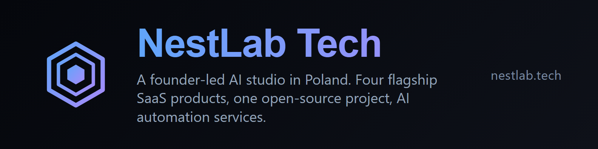
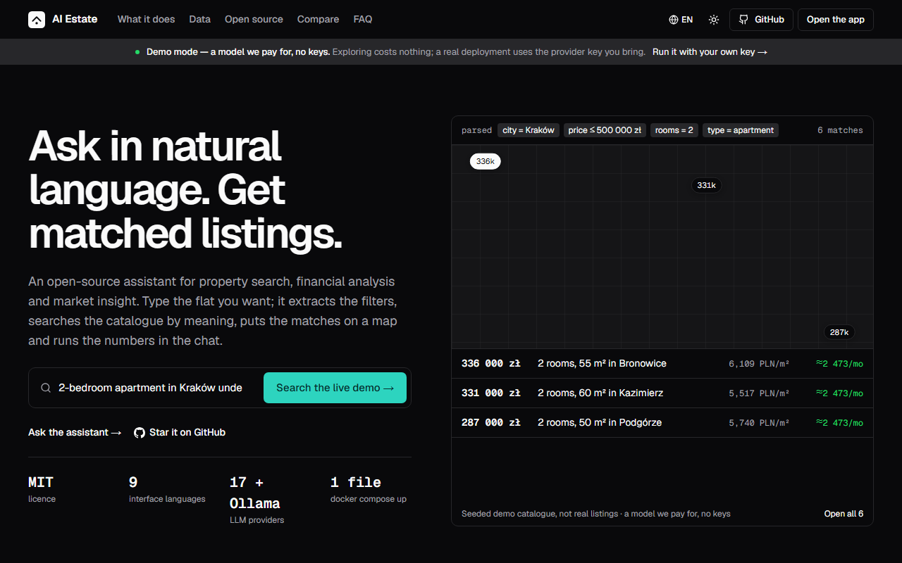
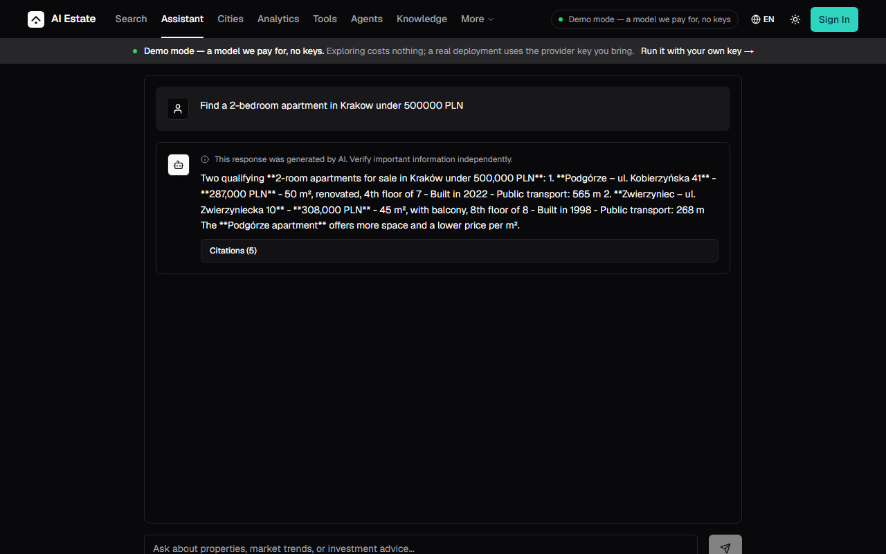
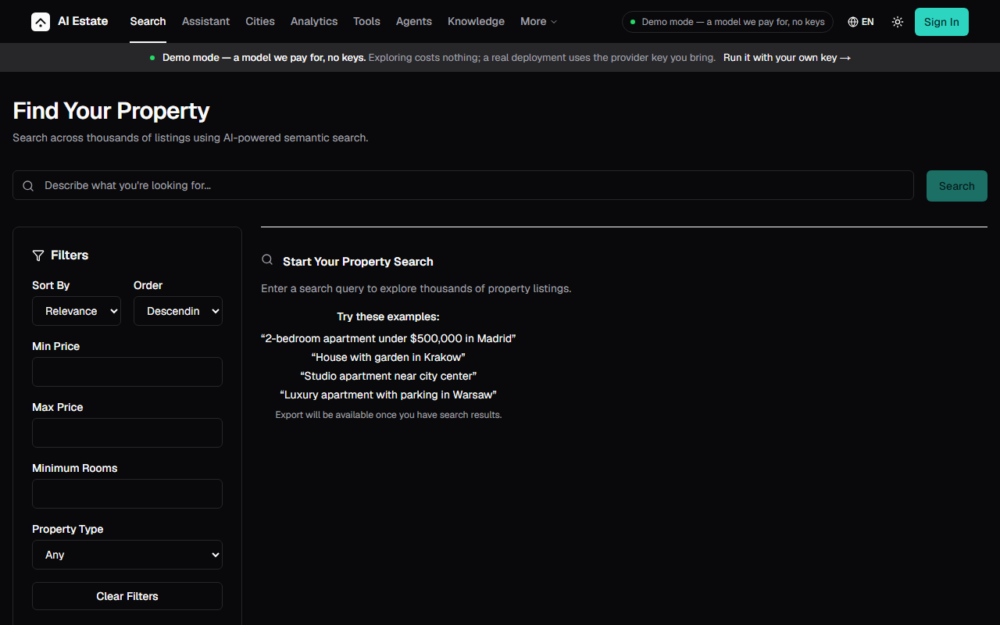
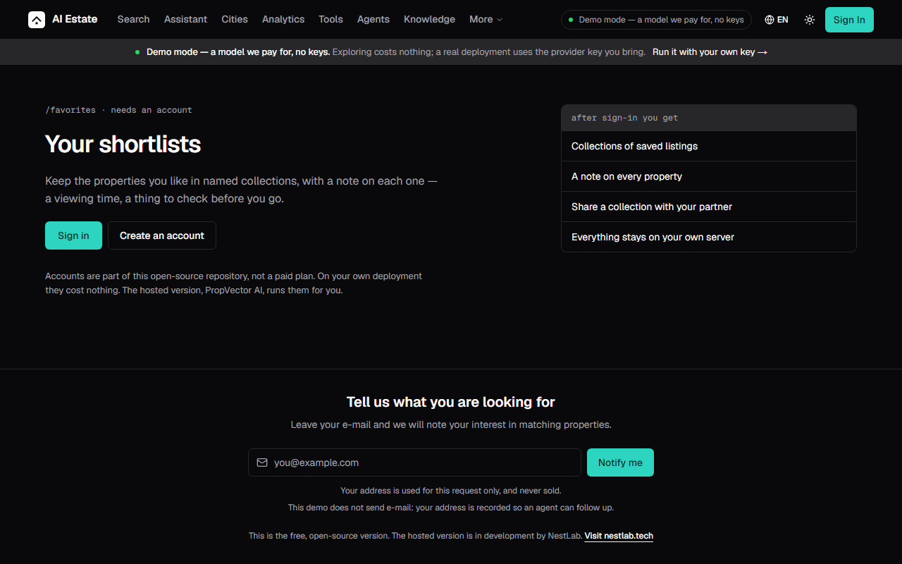

# Aleksandr Nesterovich

**NestLab Tech — A founder-led AI studio in the EU. Four flagship SaaS products, one open-source project, AI automation services.**

**Studio first.** We build our own products and take on a limited number of client contracts each year. The studio is the product; the work is what the studio is good at.

[What we do](#what-we-do) · [The portfolio](#the-portfolio) · [How we work](#how-we-work) · [Open source](#open-source) · [Stack](#stack) · [Work with us](#work-with-us)

---

## What we do

Four ways to work with us. Each one starts with a few sentences about the problem.
Detail on [nestlab.tech/services](https://nestlab.tech/services?utm_source=github&utm_medium=referral&utm_campaign=product_showcase&utm_content=readme).

| Service | What it is |
|---|---|
| **AI workflow automation** | Lead routing and follow-up, document intake, reporting, internal alerts and approvals. Where a step needs judgement we add an LLM step with guardrails and a human-review path. |
| **Custom AI software development** | A production-ready first slice in four weeks: auth, one core flow, deployment, monitoring and backups wired from day one. Boring technology, no vendor lock-in. |
| **AI integration services** | Retrieval-augmented search, assistants and extraction added to software you already run, with evaluation and cost limits so the feature stays predictable. |
| **EU AI Act compliance** | We build and operate the [EU AI Act Scanner](https://nestlab.tech/products/euaigap), an automated assessment for Regulation 2024/1689, and apply the same method to client work. Preparation support, not legal advice. |

---

## The portfolio

Four products under our own brand, plus the open-source project they are built on.
Dated case studies on [nestlab.tech/work](https://nestlab.tech/work?utm_source=github&utm_medium=referral&utm_campaign=product_showcase&utm_content=readme).

| | Product | What it does | Status |
|---|---|---|---|
|  | [**EU AI Act Scanner**](https://nestlab.tech/products/euaigap?utm_source=github&utm_medium=referral&utm_campaign=product_showcase&utm_content=readme) | Automated EU AI Act (Regulation 2024/1689) compliance assessment: 5-tier risk classification, 8-area scoring, 4 generated compliance documents. | Live |
|  | [**PropVector AI**](https://nestlab.tech/products/propvectorai?utm_source=github&utm_medium=referral&utm_campaign=product_showcase&utm_content=readme) | Commercial AI real-estate SaaS. ChromaDB vector search, MLS integration, 9 languages, ROI / CMA valuation, multi-year price forecast. In development. | In development |
|  | [**CheckCV**](https://nestlab.tech/products/checkcv?utm_source=github&utm_medium=referral&utm_campaign=product_showcase&utm_content=readme) | Professional CV analysis for recruiting teams. Multi-format parsing, AI scoring, weighted rubric, candidate pipeline, white-label branding. In development. | In development |
|  | [**TuneCV**](https://nestlab.tech/products/tunecv?utm_source=github&utm_medium=referral&utm_campaign=product_showcase&utm_content=readme) | AI-powered resume optimization for job seekers. ATS scoring, AI suggestions, cover-letter generation, interview prep, application tracker. In development. | In development |
|  | [**OpenStore**](https://nestlab.tech/products/openstore?utm_source=github&utm_medium=referral&utm_campaign=product_showcase&utm_content=readme) | Open-source AI real-estate search, MIT licensed. RAG with ChromaDB, 17 LLM providers, 9 languages. The open-source sibling of PropVector AI. | MIT |

---

## How we work

- **Fixed first milestone** — scoped and priced before kickoff, then written into the scope.
- **Founder-led delivery** — the person you contact stays with the work, from written scope through operation.
- **EU data residency by default** — product runtimes on our own infrastructure in Germany, France and Canada. DPA and subprocessor list published.
- **Daily written update, weekly call** — remote-first, based in the EU.

---

## Open source

The code we publish is the code we run. Every public repository, with its live demo where there is one.

| Repository | What it is | Stars | Live |
|---|---|---|---|
| [**ai-real-estate-assistant**](https://github.com/AleksNeStu/ai-real-estate-assistant) | Open-source AI real estate search with RAG, vector search, multi-provider LLMs, FastAPI, Next.js, ChromaDB, and a live demo. | 321 | [open](https://realty.kittray.com/?utm_source=github&utm_medium=referral&utm_campaign=product_showcase&utm_content=readme) |
| [**ai-news-scraper**](https://github.com/AleksNeStu/ai-news-scraper) | AI-powered news scraper with semantic search, RSS subscriptions, and AI-generated summaries. FastAPI + Next.js + ChromaDB monorepo. | 0 | [open](https://nestlab.tech?utm_source=github&utm_medium=referral&utm_campaign=product_showcase&utm_content=readme) |

**AleksNeStu/ai-real-estate-assistant** - 321 stars, 119 forks, MIT.

**A conversational assistant for property search, analytics and market insight.** Ask in natural language — *"2-bedroom apartment in Kraków under 500k"* — and it answers from a semantic index over the catalogue, with the tools behind the chat: mortgage, rent-vs-buy, ROI, TCO, valuation. The landing page is open; the app asks for a free account; the demo answers with a model we pay for.

Retrieval over 17 LLM providers behind one interface, in 9 languages. The assistant cites the catalogue it read, and every price carries its currency.

[Live demo](https://realty.kittray.com/?utm_source=github&utm_medium=referral&utm_campaign=product_showcase&utm_content=readme)

---

## Stack

The stack the open-source project runs on, mirrored from its own Tech Stack table.

| Layer | Technology |
|---|---|
| Backend API | FastAPI (Python 3.12+) |
| Frontend | Next.js 16 + React 19 |
| Vector DB | ChromaDB (semantic search + MMR reranking) |
| Relational DB | PostgreSQL / SQLite |
| LLM Providers | OpenAI, Anthropic, Google, Grok, DeepSeek, MiniMax, OpenRouter, Together AI, Fireworks AI, HuggingFace, Groq, Mistral, Qwen, ZAI, Moonshot, OpenCode, local Ollama |
| Container | Docker / Docker Compose |
| Hosting (staging) | Render free tier |
| CI/CD | GitHub Actions (CI + GHCR + Render deploy) |
| Monitoring | Uptime Kuma + structured logs |

---
## Work with us

**Bring the real problem — we size it live.**

[Free 30-minute call](https://nestlab.tech/book-a-call?utm_source=github&utm_medium=referral&utm_campaign=product_showcase&utm_content=readme) &middot; [Start a project](https://nestlab.tech/contact?utm_source=github&utm_medium=referral&utm_campaign=product_showcase&utm_content=readme) &middot; [nestlab.tech](https://nestlab.tech?utm_source=github&utm_medium=referral&utm_campaign=product_showcase&utm_content=readme) &middot; [LinkedIn (studio)](https://www.linkedin.com/company/nestlab-tech) &middot; [GitHub (studio)](https://github.com/NestLab-Tech)

---
